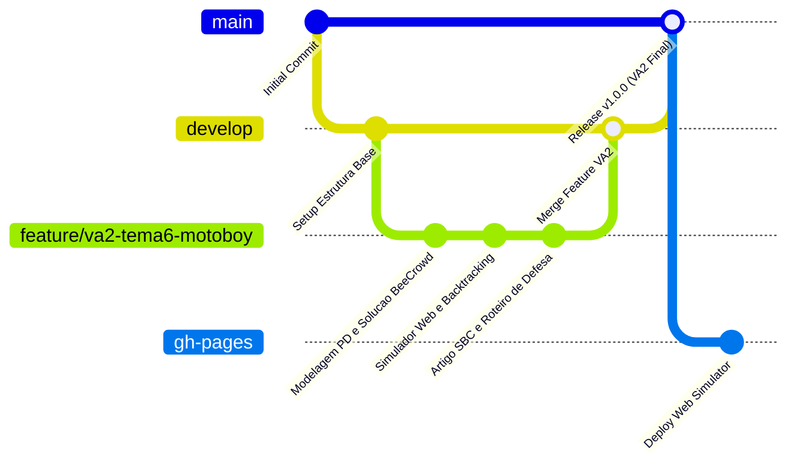

# 🍕 PAA 2026.2 - Resolução do Problema do Motoboy (BeeCrowd 1286)
> **Universidade Federal Rural de Pernambuco (UFRPE)**  
> **Departamento de Computação — Bacharelado em Ciência da Computação**  
> **Disciplina:** Projeto e Análise de Algoritmos (PAA) – Período Letivo 2026.2  
> **Docente:** Profª. Drª. Jeane Melo  
> **Discente / Autor:** José Albérico Rocha da Silva  
> **Contato:** `albericolx@gmail.com`  

[](https://judge.beecrowd.com/pt/problems/view/1286)
[](https://www.python.org/)
[](article/artigo_sbc_tema6_motoboy.pdf)
[](#-modelo-de-ramificação-gitflow)
[](https://albericolx.github.io/PAA_2026_2_Projeto/)

---

## 📌 Sumário Executivo

Este repositório contém a entrega completa e rigorosa da **Segunda Verificação de Aprendizagem (VA-02)** da disciplina de Projeto e Análise de Algoritmos (PAA), focada na resolução formal, modelagem matemática, análise assintótica e implementação computacional do **Tema 6 — BeeCrowd 1286: Motoboy**.

O projeto estabelece a redução isomórfica formal do problema logístico ao clássico **Problema da Mochila Binária 0-1 (*0-1 Knapsack Problem*)**, classificado como NP-completo por Richard Karp (1972). Demonstra-se matematicamente a falibilidade de abordagens gulosas e a inviabilidade de busca por força bruta $O(2^N)$, fundamentando a adoção do paradigma de **Programação Dinâmica (PD)** com a **Equação de Bellman**, associada a uma otimização espacial em $O(P)$ e recuperação ótima via **Backtracking passo a passo**.

Além do código oficial aceito no juiz eletrônico, foram desenvolvidos **três ambientes de simulação didática** (Web interativo zero-dependências, CLI em Python puro e Dashboard Streamlit) e o **Artigo Científico completo no padrão SBC (Sociedade Brasileira de Computação)** em PDF (4 páginas) e DOCX.

---

## 🚀 Acesso Rápido aos Simuladores

| Ferramenta | Descrição | Como Acessar / Executar |
| :--- | :--- | :--- |
| **🌐 Simulador Web (HTML5/JS)** | Aplicação interativa em tela única (zero rolagem), com iluminação de fórmulas em tempo real e Backtracking passo a passo | [👉 Abrir Demo Online](https://albericolx.github.io/PAA_2026_2_Projeto/) ou abrir localmente `index.html` |
| **🐍 Simulador CLI em Python Puro** | Script para terminal ou VS Code com menus interativos, matriz colorida ANSI e auditoria explicativa de Backtracking | `python code/simulador_interativo_motoboy.py` |
| **📊 Dashboard Streamlit** | Interface gráfica com controles dinâmicos, abas de exploração e detalhamento matemático | `streamlit run code/app_motoboy_streamlit.py` |
| **⚡ Solução BeeCrowd Oficial** | Implementação de alto desempenho em $O(P)$ submetida e aceita no juiz eletrônico | `python code/solucao_beecrowd_1286.py` |

---

## 🏛️ Estrutura do Repositório (Padrão Workspace OS & Gitflow)

A organização deste repositório segue rigorosamente a estrutura modular de projetos acadêmicos e o padrão Gitflow adotado em [`albericolx/Topicos_Avancados_IA`](https://github.com/albericolx/Topicos_Avancados_IA):

```text
PAA_2026_2_Projeto/
├── index.html                           # Simulador Web Oficial (hospedado no GitHub Pages)
├── simulador_visual_motoboy.html        # Espelho standalone da ferramenta didática
├── README.md                            # Documentação consolidada do repositório
├── .gitignore                           # Regras de exclusão Git (ambientes virtuais, caches)
│
├── code/                                # Subrepositório de Códigos-Fonte
│   ├── solucao_beecrowd_1286.py         # Código de produção BeeCrowd (O(N·P) tempo, O(P) espaço)
│   ├── simulador_interativo_motoboy.py  # Simulador interativo em Python puro com Backtracking
│   ├── app_motoboy_streamlit.py         # Dashboard Streamlit interativo
│   ├── solucao_didatica_visual.py       # Script didático comentado linha a linha
│   ├── casos_de_teste.txt               # Casos de teste oficiais do BeeCrowd
│   └── gerador_oficial_sbc_pdf_docx.py  # Script de compilação dos artigos PDF e Word
│
├── article/                             # Produção Científica e Artigos
│   ├── artigo_sbc_tema6_motoboy.pdf     # Artigo científico oficial no template SBC (4 páginas)
│   ├── artigo_sbc_tema6_motoboy.docx    # Versão editável Word com print e tabelas integradas
│   ├── artigo_sbc_tema6_motoboy.md      # Fonte completa em Markdown
│   ├── artigo_abnt_tema6_motoboy.rtf    # Versão formatada em conformidade com normas ABNT
│   └── print_aceite_beecrowd_1286.png   # Comprovação de aceite (Submissão # 50429092)
│
└── docs/                                # Roteiros de Apresentação e Materiais de Apoio
    ├── roteiro_apresentacao_slides_didatico.md # Roteiro de 20 minutos (10 slides) para defesa oral
    ├── detalhamento_calculo_matriz_4x10.md    # Rastreamento analítico das 55 células (N=4, P=10)
    └── PAA_SegundaVA_Projeto_2026_2_Equipes.docx.pdf # Diretrizes oficiais da Profª Jeane Melo
```

---

## 🌿 Modelo de Ramificação Gitflow

O repositório adota o modelo **Gitflow** estruturado em branches com responsabilidades segregadas:



* **`main`**: Ramo de produção contendo unicamente código estável, testado e validado academicamente (versão final da VA-02).
* **`develop`**: Ramo de integração contínua onde as contribuições e refatorações são consolidadas.
* **`feature/va2-tema6-motoboy`**: Ramo de desenvolvimento focado na modelagem, implementações em Python, simuladores e artigos.
* **`gh-pages`**: Ramo dedicado à hospedagem automatizada do Simulador Web via GitHub Pages.

---

## 📐 Fundamentação Teórica e Modelagem Matemática

### 1. Mapeamento Isomórfico (Mochila 0-1)
O problema modela as entregas de José, motoboy de uma pizzaria que deve escolher pedidos para maximizar o tempo de trabalho diário condicionado à capacidade $P$ do baú da moto:

$$\text{Maximizar } Z = \sum_{i=1}^{N} t_i \cdot x_i \quad \text{sujeito a: } \sum_{i=1}^{N} p_i \cdot x_i \le P, \quad x_i \in \{0, 1\}$$

* **Capacidade da Mochila ($W$):** Capacidade máxima da bag de José ($P$ pizzas).
* **Peso do Item ($w_i$):** Quantidade de pizzas do pedido ($p_i$).
* **Valor do Item ($v_i$):** Tempo de entrega em minutos ($t_i$).
* **Variável Binária ($x_i \in \{0, 1\}$):** Indivisibilidade estrita (o pedido é levado integralmente ou recusado).

### 2. Equação de Recorrência de Bellman
Seja $DP[i][w]$ o tempo máximo alcançável considerando os primeiros $i$ pedidos com uma bag restrita a $w$ pizzas:

$$DP[i][w] = \begin{cases} 
0 & \text{se } i = 0 \text{ ou } w = 0 \\
DP[i-1][w] & \text{se } p_i > w \quad \text{(Caso 1: Não Cabe)} \\
\max\Big(DP[i-1][w], \; DP[i-1][w - p_i] + t_i\Big) & \text{se } p_i \le w \quad \text{(Caso 2: Cabe na Bag)}
\end{cases}$$

### 3. Rastreamento do Backtracking (Reconstrução Ótima)
A decisão sobre cada pedido é auditada de trás para frente (do Pedido #N até o #1):
* **Se $DP[i][w] \neq DP[i-1][w]$:** O valor aumentou em relação à linha anterior $\implies$ **Pedido #i FOI LEVADO!** Desconta-se a capacidade: $w \leftarrow w - p_i$.
* **Se $DP[i][w] == DP[i-1][w]$:** O ótimo já existia sem este item $\implies$ **Pedido #i FOI DESCARTADO!** Mantém-se $w$.

---

## 📊 Caso de Teste Oficial 1 BeeCrowd ($N=4, P=10$)

Entradas: $P=10$ pizzas, $N=4$ pedidos: `#1 (20m, 5pz)`, `#2 (70m, 7pz)`, `#3 (15m, 2pz)`, `#4 (25m, 3pz)`.

### Matriz Completa de Programação Dinâmica $DP[i][w]$:

| $i \backslash w$ | 0 | 1 | 2 | 3 | 4 | 5 | 6 | 7 | 8 | 9 | 10 |
| :---: | :---: | :---: | :---: | :---: | :---: | :---: | :---: | :---: | :---: | :---: | :---: |
| **0 (base)** | 0 | 0 | 0 | 0 | 0 | 0 | 0 | 0 | 0 | 0 | 0 |
| **1 (20m, 5p)** | 0 | 0 | 0 | 0 | 0 | 20 | 20 | 20 | 20 | 20 | 20 |
| **2 (70m, 7p)** | 0 | 0 | 0 | 0 | 0 | 20 | 20 | 70 | 70 | 70 | 70 |
| **3 (15m, 2p)** | 0 | 0 | 15 | 15 | 15 | 20 | 20 | 70 | 70 | 85 | 85 |
| **4 (25m, 3p)** | 0 | 0 | 15 | 25 | 25 | 40 | 40 | 70 | 70 | 85 | **95** |

* **Auditoria de Backtracking:**
  1. $DP[4][10] (95m) \neq DP[3][10] (85m) \implies$ **Pedido #4 Levado!** ($w = 10 - 3 = 7$)
  2. $DP[3][7] (70m) == DP[2][7] (70m) \implies$ **Pedido #3 Descartado!** ($w = 7$)
  3. $DP[2][7] (70m) \neq DP[1][7] (20m) \implies$ **Pedido #2 Levado!** ($w = 7 - 7 = 0$)
  4. Mochila esgotada ($w = 0$) $\implies$ **Pedido #1 Descartado.**
* **Decisão Final:** Pedidos selecionados: **{Pedido #2, Pedido #4}**  
  Tempo total: **95 minutos** | Pizzas: **10 de 10 (100% da bag ocupada)**.

---

## 💻 Instruções de Instalação e Execução

### Pré-requisitos
* Python 3.9 ou superior instalado.
* Navegador moderno (Google Chrome, Microsoft Edge, Mozilla Firefox).

### 1. Clonar o Repositório
```bash
git clone https://github.com/albericolx/PAA_2026_2_Projeto.git
cd PAA_2026_2_Projeto
```

### 2. Executar o Simulador Web (Sem Instalar Nada)
Basta abrir o arquivo `index.html` em qualquer navegador:
```bash
# Windows
start index.html

# Linux / Mac
xdg-open index.html || open index.html
```
Ou acesse diretamente a versão online: **[https://albericolx.github.io/PAA_2026_2_Projeto/](https://albericolx.github.io/PAA_2026_2_Projeto/)**.

### 3. Executar o Simulador Interativo em Terminal (Python Puro)
```bash
python code/simulador_interativo_motoboy.py
```

### 4. Executar o Dashboard Streamlit (Opcional)
```bash
pip install streamlit pandas
streamlit run code/app_motoboy_streamlit.py
```

---

## 📜 Declaração de Integridade Acadêmica (Portaria nº 2.664/2026 – CNPq)

Em cumprimento ao Artigo 9º da Portaria nº 2.664/2026 do Conselho Nacional de Desenvolvimento Científico e Tecnológico (CNPq), declara-se que ferramentas de Inteligência Artificial Generativa (Google Antigravity / Gemini) foram utilizadas de forma ética e transparente como suporte auxiliar na estruturação e revisão analítica. O código-fonte, modelagem matemática, experimentação prática e a defesa do projeto são de integral autoria e responsabilidade do estudante **José Albérico Rocha da Silva**.

---

## 📚 Referências Bibliográficas

* BEECROWD. **Problema 1286: Motoboy**. BeeCrowd Academic Online Judge, 2026. Disponível em: <https://judge.beecrowd.com/pt/problems/view/1286>.
* BELLMAN, Richard. The theory of dynamic programming. **Bulletin of the American Mathematical Society**, v. 60, n. 6, p. 503-515, 1954.
* BELLMAN, Richard. **Dynamic Programming**. Princeton, NJ: Princeton University Press, 1957.
* BELLMAN, Richard. **Eye of the Hurricane: An Autobiography**. Singapore: World Scientific Publishing, 1984.
* CORMEN, Thomas H. et al. **Algoritmos: teoria e prática**. 3. ed. Rio de Janeiro: Elsevier, 2012.
* DANTZIG, George B. Discrete-variable extremum problems. **Operations Research**, v. 5, n. 2, p. 266-277, 1957.
* KARP, Richard M. Reducibility among combinatorial problems. *In*: MILLER, R. E.; THATCHER, J. W. (Ed.). **Complexity of Computer Computations**. New York: Plenum Press, 1972. p. 85-103.
* KLEINBERG, Jon; TARDOS, Éva. **Algorithm design**. Boston: Pearson/Addison-Wesley, 2006.
* SOCIEDADE BRASILEIRA DE COMPUTAÇÃO (SBC). **Instruções para autores de artigos da SBC**. Porto Alegre: SBC, 2024.
