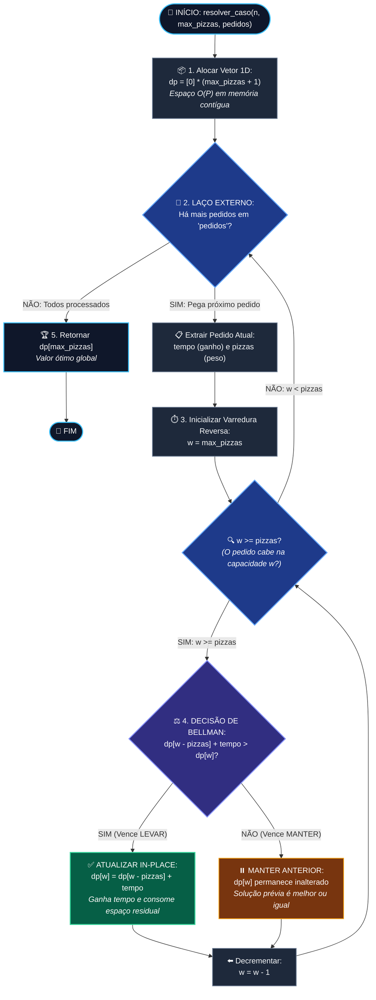

# 📐 Diagrama de Blocos e Fluxo de Tomada de Decisão: Otimização Espacial O(P)
> **Universidade Federal Rural de Pernambuco (UFRPE)**  
> **Departamento de Computação — Projeto e Análise de Algoritmos (PAA) – 2026.2**  
> **Docente:** Profª. Drª. Jeane Melo  
> **Discente / Autor:** José Albérico Rocha da Silva  
> **Tema:** Tema 6 – BeeCrowd 1286: Motoboy (Mochila Binária 0-1)  

---

## 1. Código de Produção Analisado

```python
def resolver_caso(n, max_pizzas, pedidos):
    # 1. Alocação do vetor 1D inicializado com zeros
    dp = [0] * (max_pizzas + 1)
    
    # 2. Laço Externo: Processa cada pedido sequencialmente
    for tempo, pizzas in pedidos:
        # 3. Laço Interno: Varredura DECRESCENTE para garantir propriedade 0-1
        for w in range(max_pizzas, pizzas - 1, -1):
            # 4. Decisão de Bellman In-Place: Levar vs Manter
            if dp[w - pizzas] + tempo > dp[w]:
                dp[w] = dp[w - pizzas] + tempo
                
    # 5. O valor ótimo global reside na última posição
    return dp[max_pizzas]
```

---

## 2. Fluxograma em Mermaid (Diagrama de Blocos Completo)



---

## 3. Por que a Varredura DECRESCENTE é o Ponto Crítico da Lógica?

### ❌ Se a varredura fosse CRESCENTE ($w = pizzas \to P$):
O mesmo item seria somado **múltiplas vezes**, violando a restrição binária 0-1 e transformando o algoritmo na Mochila Ilimitada (*Unbounded Knapsack*):
* Suponha um pedido com `tempo = 20`, `pizzas = 2` e vetor inicial zerado:
  * Em $w=2$: $dp[2] = \max(0, dp[0] + 20) = 20$.
  * Em $w=4$: $dp[4] = \max(0, dp[2] + 20) = 20 + 20 = \mathbf{40}$! *(Erro: o pedido foi duplicado na mesma bag!)*

### ✅ Como a varredura DECRESCENTE ($w = P \to pizzas$) resolve perfeitamente:
Como iteramos da direita para a esquerda:
* Ao calcular a posição $w$, a posição $w - pizzas$ ainda **NÃO foi modificada nesta rodada**!
* Portanto, $dp[w - pizzas]$ contém genuinamente o resultado da rodada anterior ($i-1$).
* Cada pedido é computado no máximo **UMA ÚNICA VEZ por rota**, garantindo 100% de precisão matemática sem precisar de matriz bidimensional!

---

## 4. Evolução Numérica do Vetor $DP$ no Caso BeeCrowd 1 ($N=4, P=10$)

| Estágio de Execução | $w=0$ | $w=1$ | $w=2$ | $w=3$ | $w=4$ | $w=5$ | $w=6$ | $w=7$ | $w=8$ | $w=9$ | $w=10$ |
| :--- | :---: | :---: | :---: | :---: | :---: | :---: | :---: | :---: | :---: | :---: | :---: |
| **Inicial (`dp = [0]*11`)** | 0 | 0 | 0 | 0 | 0 | 0 | 0 | 0 | 0 | 0 | 0 |
| **Após Pedido 1 (20m, 5pz)** | 0 | 0 | 0 | 0 | 0 | **20** | **20** | **20** | **20** | **20** | **20** |
| **Após Pedido 2 (70m, 7pz)** | 0 | 0 | 0 | 0 | 0 | 20 | 20 | **70** | **70** | **70** | **70** |
| **Após Pedido 3 (15m, 2pz)** | 0 | 0 | **15** | **15** | **15** | 20 | 20 | 70 | 70 | **85** | **85** |
| **Após Pedido 4 (25m, 3pz)** | 0 | 0 | 15 | **25** | **25** | **40** | **40** | 70 | 70 | 85 | **🔥 95** |

* **Resultado Ótimo Global:** `dp[10] = 95 minutos`.
* **Consumo de Memória:** Apenas 11 posições inteiras em vez das 55 da matriz $5 \times 11$.

---

## 5. Roteiro Verbal para a Apresentação Oral (Slide de Otimização)

> *"Professora Jeane, na nossa solução oficial do BeeCrowd nós implementamos uma otimização clássica de engenharia de software:*  
> *Em vez de guardarmos a matriz inteira de 55 células, nós notamos que para calcular a linha atual $i$, nós só olhamos para a linha imediatamente acima $i-1$. Por isso, reduzimos toda a matriz a um **único vetor unidimensional de tamanho $P+1$**, economizando mais de $95\%$ de memória RAM.*  
>  
> *O grande segredo matemático dessa implementação é que o laço de capacidades precisa rodar **da direita para a esquerda (decrescente)**. Se rodássemos da esquerda para a direita, um pedido seria somado várias vezes na mesma viagem da moto. Ao rodar de trás para frente, quando calculamos `dp[w]`, a posição `dp[w - pizzas]` ainda guarda o valor da rodada anterior, garantindo que o pedido seja considerado no máximo uma única vez, preservando a propriedade 0-1 da mochila!"*
